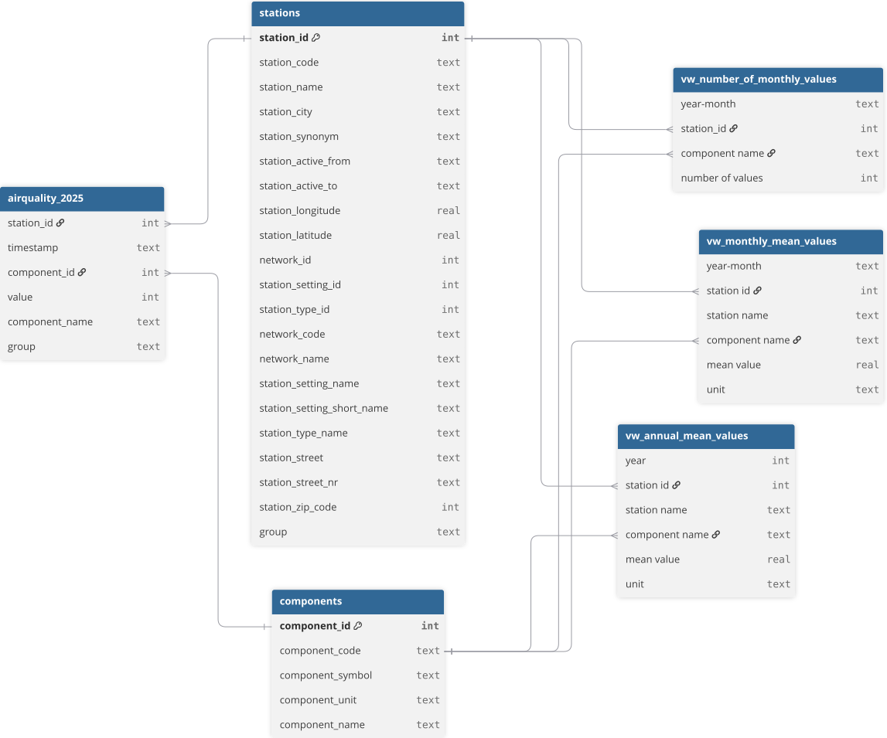

# Analyse der Luftqualität in Deutschland 2025

## Projektüberblick
Dieses Projekt untersucht die Luftqualität an fünf ausgewählten Messstationen in Deutschland im Jahr 2025. Näher betrachtet werden dabei die Schadstoffe Feinstaub (PM10), Ozon (O₃) und Stickstoffdioxid (NO₂).

Die Daten werden über die API des Umweltbundesamtes (UBA) abgerufen, mit Python aufbereitet, in eine SQLite-Datenbank überführt und mithilfe von SQL-Abfragen ausgewertet. Die Ergebnisse werden in einem interaktiven Power BI-Dashboard visualisiert.

Das Projekt bildet eine vollständige Datenpipeline von der Datenerhebung bis zur Visualisierung ab. Ein besonderer Schwerpunkt liegt auf der Auswahl der Messstationen, der Prüfung der Datenqualität und der strukturierten Bereitstellung der Daten für die weitere Analyse.

Verwendete Technologien: Python | REST API | JSON | pandas | SQL | SQLite | Power BI | DAX | dbdiagram.io

## 1. Zielsetzung und Fragestellungen
Ziel des Projekts ist es, die Luftqualität an ausgewählten Messstationen in Deutschland vergleichend zu untersuchen und unterschiedliche Belastungsmuster sichtbar zu machen.

Daraus ergeben sich folgende Fragestellungen:

- Wie unterscheiden sich die Konzentrationen von PM10, O₃ und NO₂ zwischen Messstationen mit unterschiedlichen Standorttypen?

- Welche zeitlichen Muster lassen sich anhand monatlicher Mittelwerte erkennen?

- Wie unterscheiden sich die Jahresmittelwerte der untersuchten Schadstoffe zwischen den ausgewählten Standorten?

- Wie vollständig sind die verfügbaren Messdaten und welche Einschränkungen ergeben sich daraus für die Interpretation?

Das Projekt dient zugleich als praktische Anwendung eines vollständigen Analyseprozesses: von der Anbindung einer externen Datenquelle über die Datenaufbereitung und SQL-basierte Analyse bis hin zur interaktiven Visualisierung.

Untersuchungszeitraum: 01.01.2025–31.12.2025  
Untersuchungsumfang: 5 Messstationen und 3 Schadstoffe

## 2. Datensatz und Datenquelle
Die verwendeten Messdaten stammen aus dem Luftdatenangebot des Umweltbundesamtes. Der Zugriff erfolgt über die UBA Air Data API.

    Datenquelle: https://luftdaten.umweltbundesamt.de/
    Zeitraum: Kalenderjahr 2025
    Schadstoffe: PM10, O₃ und NO₂
    Messintervall: stündliche Messwerte
    Umfang: fünf ausgewählte Messstationen in Deutschland

## 3. Methodik und Datenpipeline
Die Umsetzung erfolgte in mehreren aufeinander aufbauenden Schritten.

### 3.1 Auswahl der Schadstoffe
Die Schadstoffe PM10, O₃ und NO₂ wurden anhand ihrer Relevanz und Wirkung auf die menschliche Gesundheit ausgewählt. Die ausgewählten Schadstoffe (s. Tab. 1) gehören zu den wichtigsten Luftschadstoffen, bereits eine geringe Konzentration in der Luft kann die Gesundheit beeinträchtigen. (vgl. https://www.umweltbundesamt.de/themen/luft/wirkungen-von-luftschadstoffen/wirkungen-auf-die-gesundheit#auenluft (abgerufen am 06.10.2026))

*Tabelle 1: Ausgewählte Schadstoffe*  
| Schadstoff | Bedeutung	                                                       |
| ---------- | ------------------------------------------------------------------- | 
| PM10	     | Feinstaub mit einem aerodynamischen Durchmesser von höchstens 10 µm | 
| O₃	     | Bodennahes Ozon	                                                   | 
| NO₂	     | Stickstoffdioxid	                                                   | 

### 3.2 Auswahl der Messstationen
Skript: `src/select_stations.py`

Für die Analyse wurden zunächst alle Messstationen betrachtet, die im gesamten Jahr 2025 aktiv waren. Anschließend wurden anhand von Umgebung und Messsituation fünf Stationengruppen definiert:

- Urban Traffic - verkehrsnah
- Urban Background - städtischer Hintergrund
- Suburban Background - vorstädtischer Hintergrund
- Rural Background - ländlicher Hintergrund
- Industry - industriell geprägte Umgebung

Nach dieser Filterung standen insgesamt 1042 Kandidaten zur Verfügung.

Um die Verfügbarkeit der relevanten Schadstoffe zu prüfen, wurde zunächst eine zufällige Stichprobe von jeweils 20 Stationen aus den einzelnen Gruppen untersucht. Für jede Station wurde überprüft, ob Messwerte für die Parameter PM10, O₃ und NO₂ im September 2025 vorhanden sind. Für die Gruppe Urban Traffic wurde die Prüfung anschließend auf alle 346 Kandidaten ausgeweitet, da die zufällige Stichprobe keine Station mit allen drei relevanten Parametern enthielt.

Die so identifizierten geeigneten Stationen wurden anschließend hinsichtlich ihrer Messabdeckung im gesamten Jahr 2025 untersucht. Als Referenz wurden 8760 theoretische Stundenmessungen verwendet (365 Tage * 24 Stunden). Berücksichtigt wurden nur die Stationen mit einer Messabdeckung von mindestens 95 % für PM10, O₃ und NO₂. Für jede dieser Stationen wurde anschließend die durchschnittliche Messabdeckung der drei Schadstoffe berechnet. Pro Stationengruppe wurde die Station mit der höchsten durchschnittlichen Messabdeckung als finale Messstation ausgewählt.

Das Ergebnis sind fünf finale Messstationen, jeweils eine pro Gruppe. Die ausgewählten Stationen wurden in `data/processed/selected_stations.json` gespeichert und bilden die Grundlage für den anschließenden Datenabruf.

### 3.3 Datenabruf
Skript: `src/download_data.py`

Das Skript stellt Anfragen an die UBA Air Data API und lädt die Luftqualitätsdaten für die ausgewählten Messstationen herunter.

Die Verarbeitung umfasst:

- Abruf der Messdaten für den Zeitraum 01.01.2025 bis 31.12.2025
- Verwendung der Stationsauswahl aus data/processed/selected_stations.json
- Speicherung der API-Antworten als JSON-Dateien im Verzeichnis data/raw/

### 3.4  Datenaufbereitung 
Skript: `src/prepare_data.py`

Die heruntergeladenen JSON-Antworten werden in eine einheitliche tabellarische Struktur überführt.

Die Verarbeitung umfasst:

- Umwandlung der API-Antworten in einzelne Messwertzeilen
- Zuordnung der Schadstoffnamen anhand der Komponenten-IDs
- Konvertierung der Zeitstempel in ein Datums-/Uhrzeitformat
- Zusammenführung der Daten aller fünf Messstationen
- Ergänzung der Stationsgruppen, z.B. urban_background und urban_traffic
- Export der aufbereiteten Daten nach `data/processed/airquality_2025.csv`

### 3.5 Datenqualitätsprüfung
Vor der Analyse wurden die aufbereiteten Daten auf Vollständigkeit und Konsistenz überprüft. Dazu gehörten die Kontrolle fehlender Werte, doppelter Messungen, negativer Messwerte, fehlender Schadstoffnamen und der Zuordnung zwischen Schadstoff-IDs und Schadstoffnamen. 

Zusätzlich wurde die zeitliche Abdeckung der Messreihen untersucht, um Datenlücken sichtbar zu machen. Die Abdeckung wurde berechnet als die Anzahl der tatsächlich verfügbaren stündlichen Zeitstempel, dividiert durch die 8.760 für das Jahr 2025 erwarteten stündlichen Zeitstempel. Fehlende Zeitstempel blieben als Datenlücken bestehen und werden nicht automatisch ergänzt.

### 3.6 SQL-basierte Datenanalyse
Nach der Aufbereitung wurden die Daten in einer SQLite-Datenbank strukturiert und mit SQL-Abfragen für die weitere Analyse bereitgestellt.

Die Auswertungen umfassen:

- Monatsmittelwerte je Messstation und Schadstoff
- Jahresmittelwerte je Messstation und Schadstoff
- Anzahl verfügbarer Messwerte je Monat, Station und Schadstoff

Die aggregierten Ergebnisse werden in Views bereitgestellt. 

### 3.7 Visualisierung mit Power BI
Die aufbereiteten Daten und SQL-Auswertungen wurden in Power BI eingebunden und in einem interaktiven Dashboard dargestellt. Das Dashboard umfasst drei inhaltliche Schwerpunkte:

- Projektüberblick: Zielsetzung, Datengrundlage, ausgewählte Messstationen.
- Zeitliche Entwicklung und Datenqualität: Monatliche Mittelwerte, Jahresmittelwerte und Datenvollständigkeit.
- Vergleich und Fazit: Gegenüberstellung der Jahresmittelwerte und Zusammenfassung der wichtigsten Beobachtungen.

Ein Filter für die Schadstoffe ermöglicht es, die dargestellten Ergebnisse gezielt nach PM10, O₃ oder NO₂ zu untersuchen.

## 4. Datenstruktur
Die Daten wurden in einer relationalen Struktur organisiert. Die Messwerte bilden die zentrale Tabelle. Ergänzende Tabellen enthalten Informationen zu den Messstationen und Schadstoffkomponenten. Views stellen die Ergebnisse für die Analyse bereit. Das Datenbankschema ist in Abbildung 1 gezeigt.

*Abbildung 1: Relationale Datenstruktur mit Messdaten, Stationen, Schadstoffkomponenten und Views.*

## 5. Ergebnisse
### 5.1 Datenqualitätsprüfung
Die Ergebnisse der Prüfung auf Vollständigkeit und Konsistenz sind in Tabelle 2 gezeigt und die ermittelten Messwert-Abdeckungen in Tabelle 3.

*Tabelle 2: Ergebnisse der Überprüfung der Datenqualität* 
| Prüfung                       | Ergebnis                               | Bewertung                                                         |
| ----------------------------- | -------------------------------------- | ----------------------------------------------------------------- |
| Datensätze                    |                                180.288 | 5 Stationen, Jahr 2025                                            |
| Fehlende Werte                |                                      0 | Keine fehlenden Werte in den geprüften Spalten                    |
| Doppelte Messungen            |                                      0 | Keine Duplikate anhand von Station, Zeitstempel und Schadstoff-ID |
| Negative Messwerte            |                                      0 | Keine negativen Werte gefunden                                    |
| Fehlende Schadstoffnamen      |                                      0 | Alle Messwerte haben einen Schadstoffnamen                        |
| Konsistenz der Schadstoff-IDs |                                     ok | Jede ID ist genau einem Namen zugeordnet                          |
| Zeitliche Abdeckung           | 96,00–99,91 % bei den Zielschadstoffen | Zeitlücken sind vorhanden und wurden dokumentiert                 |

*Tabelle 3: Messwert-Abdeckung der Schadstoffe (2025)*  
| Station ID |     NO₂ |      O₃ |    PM10 |
| ---------: | ------: | ------: | ------: |
|        158 | 99,81 % | 99,81 % | 99,91 % |
|        172 | 99,75 % | 99,71 % | 99,81 % |
|        680 | 99,44 % | 99,62 % | 99,25 % |
|        952 | 96,06 % | 96,00 % | 99,75 % |
|       1438 | 99,42 % | 99,47 % | 98,86 % |

### 5.2 Luftqualität im Jahr 2025 an fünf ausgewählten Stationen
Die Auswertung zeigt unterschiedliche Belastungsmuster zwischen den fünf untersuchten Messstationen.

**Zentrale Beobachtungen:**

- NO₂: Den höchsten Jahresmittelwert weist die verkehrsnahe Station Berlin Frankfurter Allee mit 23,69 µg/m³ auf.
- PM10: Auch beim Feinstaub liegt Berlin Frankfurter Allee mit 20,82 µg/m³ an der Spitze der untersuchten Stationen.
- O₃: Der höchste Jahresmittelwert wurde am ländlichen Standort Kleiner Feldberg mit 74,73 µg/m³ festgestellt.

Diese Ergebnisse verdeutlichen, dass sich die betrachteten Schadstoffe zwischen den untersuchten Standorten unterschiedlich verteilen. Die erhöhten NO₂- und PM10-Jahresmittelwerte an der verkehrsnahen Station sind mit möglichen Einflüssen des Verkehrs und anderer lokaler Emissionsquellen vereinbar. Der höhere O₃-Jahresmittelwert am ländlichen Standort kann unter anderem mit photochemischen Prozessen, meteorologischen Bedingungen und dem Zusammenspiel verschiedener Luftschadstoffe zusammenhängen.

Aus den Jahresmittelwerten allein lassen sich die Ursachen dieser Unterschiede jedoch nicht eindeutig bestimmen. Außerdem bilden Jahresmittelwerte keine kurzfristigen Belastungsspitzen ab.

## 6. Einordnung und Ausblick
Die Ergebnisse zeigen, dass Luftschadstoffe an verschiedenen Standorten unterschiedliche Muster aufweisen und daher getrennt betrachtet werden sollten. Sie beziehen sich jedoch ausschließlich auf die fünf ausgewählten Messstationen und das Untersuchungsjahr 2025. Sie sind nicht automatisch auf ganz Deutschland oder auf alle Standorte derselben Kategorie übertragbar.

Die Datenqualitätsprüfung bildet eine wichtige Grundlage für die Interpretation der Ergebnisse. Gleichzeitig müssen die verbleibenden Zeitlücken und die begrenzte Zahl der untersuchten Stationen berücksichtigt werden.

Eine weiterführende Analyse könnte mehrere Jahre, saisonale Verläufe und meteorologische Daten einbeziehen. Dadurch ließen sich zeitliche Entwicklungen untersuchen und mögliche Einflussfaktoren besser einordnen.

## 7. Dashboard
In den Abbildungen 2 bis 4 sind Screenshots aus dem Power BI-Dashboard gezeigt.

*Abbildung 2: Projektziel, Datengrundlage und ausgewählte Messstationen.*

*Abbildung 3: Monatliche Mittelwerte, Jahresmittelwerte und Datenvollständigkeit der Messreihen.*

*Abbildung 4: Vergleich der Jahresmittelwerte von PM10, O₃ und NO₂ zwischen den ausgewählten Messstationen und zentrale Ergebnisse sowie Einordnung und Ausblick.*

## 8. Projektstruktur
air-quality-analysis/  
├── data/  
│   ├── raw/  
│   │   └── ...                    # Rohdaten aus der UBA-API  
│   └── processed/  
│   │   └── ...                    # in Python bearbeitete Daten  
├── src/  
│   ├── select_stations.py         # Auswahl geeigneter Messstationen  
│   ├── download_data.py           # Abruf der Messdaten  
│   ├── check_data.py              # Überprüfung der Daten  
│   └── prepare_data.py            # Aufbereitung und Export  
├── sql/  
│   └── sql_analysis.sql           # SQL-Abfragen und Views  
├── powerbi/  
│   ├── Luftqualitaet_2025.pbix  
│   └── ...                        # Screenshots des Dashboards  
├── schema/  
│   ├── schema.dbml  
│   └── Datenbankschema.svg  
├── README.md  
└── .gitignore  

